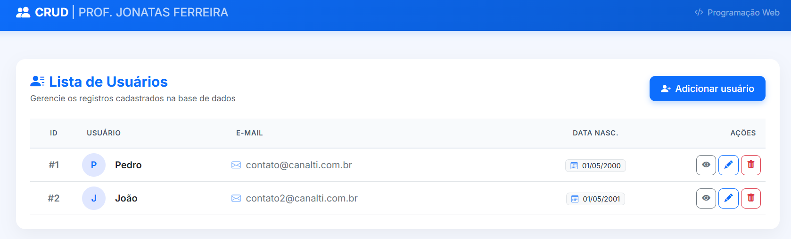

# 🚀 CRUD de Usuários em PHP, MySQL, Bootstrap & JavaScript


Este repositório contém a aplicação prática de um **CRUD (Create, Read, Update, Delete)** para gerenciamento de usuários. O projeto serve como base didática para as aulas da disciplina de **Programação Web**, ministrada pelo **@profJonatasFerreira**.

---

## 📸 Interface da Aplicação



A interface é construída com **Bootstrap 5**, oferecendo uma tabela responsiva com botões de ação rápidos para **Visualizar**, **Editar** e **Excluir** registros, além da opção de **Adicionar usuário**.

---

## 🛠️ Tecnologias Utilizadas

- **Front-end:** HTML5, CSS3, Bootstrap 5 e JavaScript (ES6+).
- **Back-end:** PHP 8.x (com PDO para conexão e manipulação segura via Prepared Statements).
- **Banco de Dados:** MySQL / MariaDB.
- **Servidor Web:** Apache (XAMPP / WAMP).

---

## 📂 Estrutura de Pastas do Projeto

```text
crud-usuarios/
├── assets/
│   ├── css/
│   │   └── style.css          # Estilos personalizados da aplicação
│   ├── js/
│   │   └── main.js            # Interatividade JS (Validações, Toast e Confirmação)
│   └── img/
│       └── preview.png        # Imagem de demonstração da interface
├── config/
│   └── conexao.php            # Conexão PDO com o banco de dados
├── db/
│   └── schema.sql             # Script SQL de criação do banco e tabela
├── index.php                  # Tela principal - Lista de Usuários (Read)
├── usuario-criar.php          # Formulário de Cadastro (Create)
├── usuario-editar.php         # Formulário de Edição (Update)
├── usuario-view.php           # Visualização detalhada do usuário
├── acoes.php                  # Script PHP de processamento (POST/GET)
└── README.md                  # Documentação do projeto
```

---

## 🗄️ Modelo de Banco de Dados (`schema.sql`)

Crie a base de dados no **phpMyAdmin** (`http://localhost/phpmyadmin`) executando o script SQL abaixo:

```sql
CREATE DATABASE IF NOT EXISTS db_crud_usuarios;
USE db_crud_usuarios;

CREATE TABLE IF NOT EXISTS usuarios (
    id INT AUTO_INCREMENT PRIMARY KEY,
    nome VARCHAR(100) NOT NULL,
    email VARCHAR(100) NOT NULL UNIQUE,
    data_nascimento DATE NOT NULL,
    senha VARCHAR(255) NOT NULL,
    created_at TIMESTAMP DEFAULT CURRENT_TIMESTAMP
);

-- Inserção de dados de exemplo para teste inicial
INSERT INTO usuarios (nome, email, data_nascimento, senha) VALUES
('Pedro', 'contato@canalti.com.br', '2000-05-01', '$2y$10$e0MYzXyjpJS7Pd0RVvHwHe1a9g1ZJ3.'),
('João', 'contato2@canalti.com.br', '2001-05-01', '$2y$10$e0MYzXyjpJS7Pd0RVvHwHe1a9g1ZJ3.');
```

---

## ⚙️ Como Executar o Projeto Localmente

### 1. Pré-requisitos

- **XAMPP** (ou ambiente similar com Apache, PHP 8+ e MySQL).
- Editor de código (ex: **VS Code**).

### 2. Passo a Passo

1. **Copiar o Projeto:**  
   Coloque a pasta `crud-usuarios` no diretório do servidor web (ex: `C:\xampp\htdocs\crud-usuarios`).

2. **Iniciar os Serviços:**  
   Abra o **XAMPP Control Panel** e inicie os módulos **Apache** e **MySQL**.

3. **Configurar o Banco de Dados:**  
   Acesse `http://localhost/phpmyadmin` no navegador e execute o código de `db/schema.sql`.

4. **Acessar no Navegador:**  
   Abra a aplicação pelo endereço:  
   `http://localhost/crud-usuarios/index.php`  
   _(ou com a porta configurada no seu ambiente, ex: `http://localhost:8081/crud-usuarios/index.php`)_.

---

## 📌 Funcionalidades do CRUD

- [x] **Create (`C`):** Formulário para cadastro de novos usuários com validação via JavaScript e criptografia de senha (`password_hash`).
- [x] **Read (`R`):** Consulta e exibição dinâmica dos dados em tabela estilizada, com formatação de data para o padrão nacional (`dd/mm/aaaa`).
- [x] **Update (`U`):** Busca do registro via parâmetro `GET`, preenchimento dinâmico do formulário e atualização via `POST`.
- [x] **Delete (`D`):** Remoção de registros via PDO com confirmação prévia em JavaScript para segurança do usuário.

---

👨‍🏫 **Docente:** Prof. Jônatas Ferreira  
📚 **Disciplina:** Programação Web
